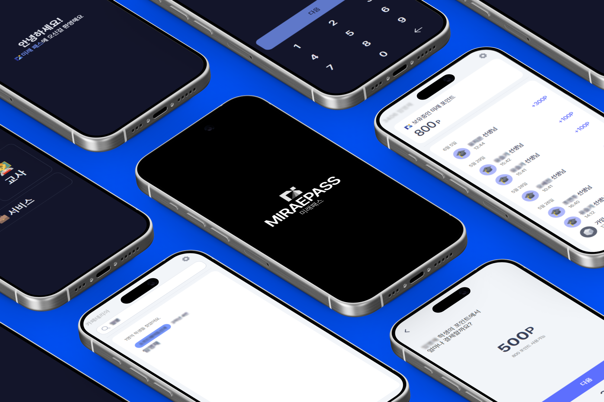

<p align="center">

</p>
<h2 align="center">MIRAEPASS</h2>
<h4 align="center">순천미래과학고등학교의 26년도에 사용하는 교내 자체 포인트 시스템</h4>
<br/>
<br/>

## 시작하기
(열심히 작성해둘게요..)

## 개발 환경
```bash
corepack enable
yarn install

yarn dev:client         # 또는 dev:admin
yarn build:client       # 또는 build:admin
yarn typecheck:client   # 또는 typecheck:admin
```

### 커밋 검사
커밋할 때 [pre-commit](https://pre-commit.com)이 스테이징된 파일의 경로에 따라 아래 검사를 실행하고, 실패하면 커밋을 막습니다.

| 경로 | 검사 |
| --- | --- |
| `server` | `ruff check --fix`, `ruff format` |
| `client` | `yarn typecheck:client` |
| `admin` | `yarn typecheck:admin` |
| `yarn.lock`, `.yarnrc.yml` | `client`, `admin` 타입 검사 모두 |

훅은 `yarn install` 때 자동으로 설치되며 [uv](https://docs.astral.sh/uv/)가 필요합니다. ruff가 파일을 수정해 커밋이 중단되면 수정된 파일을 다시 `git add`한 뒤 커밋하세요.

```bash
yarn hooks:install                         # 훅만 따로 설치
uv run --project server pre-commit run -a  # 전체 파일 검사
```

### 커밋 컨벤션
기본적으로 [Conventional Commits](https://www.conventionalcommits.org/ko/v1.0.0/)를 사용합니다.
```
<type>(<scope>): <description>

[optional body]

[optional footer(s)]
```

#### Type
- feat: 새로운 기능 추가 (버전 Minor의 영향)
- fix: 버그 수정 (버전 Patch의 영향)
- perf: 성능 개선 (버전 Patch의 영향)
- docs: 문서만 수정했을 때 (README, 주석 추가 등)
- style: 코드 의미에 영향을 주지 않는 변경사항 (들여쓰기, 세미콜론 누락, 포맷팅 수정 등)
- refactor: 코드 구조 개선
- test: 테스트 코드를 추가/수정
- build: 빌드 시스템이나 외부 의존성에 변화
- ci: CI 설정이나 스크립트 수정
- chore: 패키지 매니저 설정이나 작업, 빌드와는 관계없는 자잘한 작업
- revert: 커밋을 되돌림

#### Scope
- client: Client 관련
- server: Server 관련
- admin: Admin 관련
- sdk: SDK 재생성등 관련

### 공통 의존성
두 개 이상의 워크스페이스가 함께 쓰는 패키지의 버전은 `.yarnrc.yml`의 `catalog`에서 관리하고, 각 `package.json`에는 `"catalog:"`로 표기합니다. 버전을 올릴 때는 `.yarnrc.yml`을 수정한 뒤 `yarn install`을 실행하세요.

## SDK
앱에서는 `@miraepass/api-client`로 가져옵니다.

```ts
import { MiraepassApi, type User } from "@miraepass/api-client";
```

`api-client/src/gen`은 자동 생성되는 폴더입니다. 백엔드 서버(`http://localhost:8000/openapi.json`)를 실행한 뒤 아래 명령어로 다시 생성하세요. 주소가 다르면 `api-client/openapi-ts.config.ts`를 수정합니다.

```bash
yarn sdk-gen
```