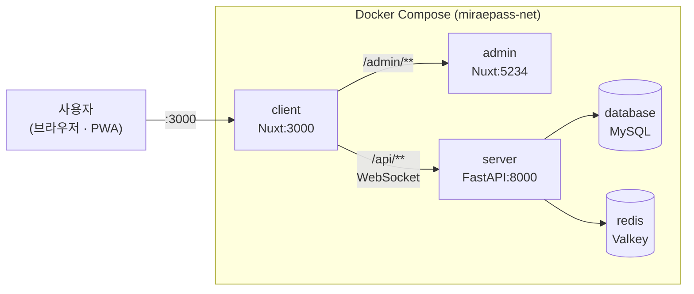
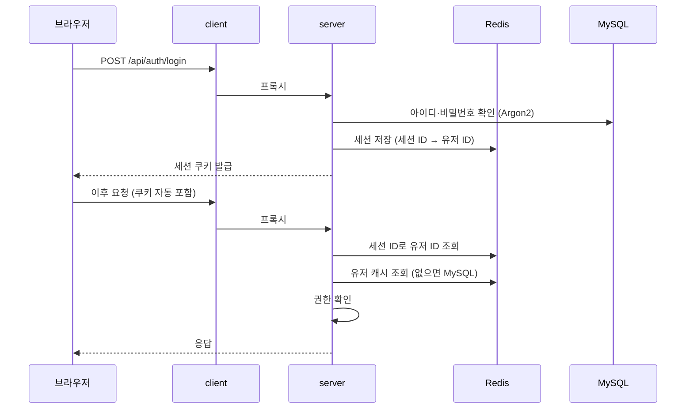
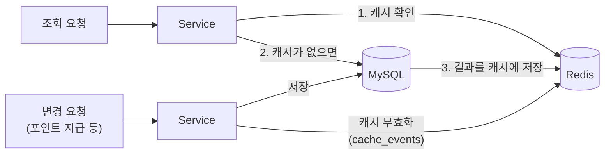
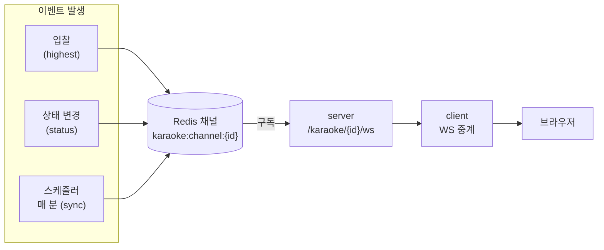
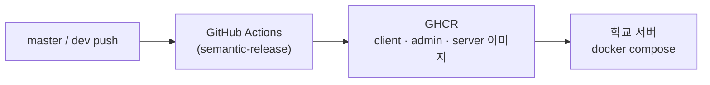

import { Callout } from 'nextra/components'

# 아키텍처
이 문서에서는 미래패스를 이루는 구성 요소와, 요청과 데이터가 그 사이를 어떻게 오가는지 설명합니다.<br />
각 구성 요소의 자세한 개발 방법은 [백엔드 개발 가이드](/docs/development/server)와 [프론트엔드 개발 가이드](/docs/development/frontend)를 참고하세요.

## 한눈에 보기



| 구성 요소 | 기술 | 포트 | 역할 |
| --- | --- | --- | --- |
| `client` | Nuxt (PWA) | `3000` | 학생·교사용 웹 앱. **외부에 열린 유일한 입구**이며, `admin`과 `server`로 요청을 중계합니다. |
| `admin` | Nuxt | `5234` | 관리자 대시보드. `/admin/` 경로 아래에서 동작합니다. |
| `server` | FastAPI | `8000` | API 서버. 모든 데이터 처리와 권한 검사를 맡습니다. |
| `database` | MySQL | - | 유저, 포인트, 게시글, 퀘스트, 스탬프, 노래방 경매 데이터 저장 |
| `redis` | Valkey (Redis 호환) | - | 로그인 세션, 캐시, 포인트 한도 집계, 노래방 경매 실시간 메시지 |
| `api-client` | Hey API | - | `server`의 OpenAPI 명세로 생성한 SDK. `client`와 `admin`이 함께 사용합니다. (빌드 시 포함되며 컨테이너는 없습니다) |

<Callout type="info">
    다섯 개의 컨테이너는 모두 `miraepass-net` 네트워크 안에 있고, 외부로 열린 포트는 `client`의 `3000` 하나뿐입니다.
    `admin`, `server`, `database`, `redis`는 외부에서 직접 접근할 수 없으며 컨테이너 이름(`server`, `admin` 등)으로 서로를 찾습니다.
</Callout>

## 요청 경로

사용자의 모든 요청은 `client`(`:3000`)로 들어오고, 경로에 따라 아래와 같이 전달됩니다.

| 경로 | 전달 대상 | 방식 |
| --- | --- | --- |
| `/admin/**` | `admin` (`http://admin:5234`) | Nitro `routeRules` 프록시 |
| `/api/**` | `server` (`http://server:8000`) | Nitro `routeRules` 프록시 (`/api` 접두사는 제거됨) |
| `/api/karaoke/{id}/ws` | `server`의 `/karaoke/{id}/ws` | `client/server/api/karaoke/[id]/ws.ts`가 직접 중계 |
| 그 외 | `client` | `client` 자체 페이지 |

- `admin`도 같은 주소(`/admin/`) 아래에서 열리기 때문에, `admin` 화면이 보내는 `/api/**` 요청 역시 `client`를 거쳐 `server`로 전달됩니다.
- 모든 요청이 같은 출처(origin)로 처리되므로, 로그인 쿠키가 `client`와 `admin`에서 함께 사용됩니다.
- Nitro의 `routeRules` 프록시는 WebSocket을 중계하지 못하기 때문에, 노래방 실시간 경매 소켓만 별도 핸들러가 중계합니다. 이 핸들러는 인증을 검사하지 않고 세션 쿠키를 그대로 `server`에 넘겨, 권한 검사는 `server`에서 이루어집니다.

## 구성 요소

### client · admin

| 항목 | `client` | `admin` |
| --- | --- | --- |
| 대상 | 학생 · 교사 | 관리자 |
| 기본 경로 | `/` | `/admin/` |
| 특징 | PWA(앱처럼 설치), 요청 중계(프록시), 노래방 WebSocket 중계 | `client`를 통해서만 접근 |

두 앱 모두 데이터베이스에 직접 접근하지 않고, [`api-client`](#api-client) SDK로 `server`의 API를 호출합니다.<br />
로그인 정보와 페이지 권한 처리는 [프론트엔드 개발 가이드](/docs/development/frontend#로그인과-세션)를 참고하세요.

### server

계층형 구조를 따르며, 요청은 아래 순서로 처리됩니다. 계층별 역할은 [백엔드 개발 가이드의 구조](/docs/development/server#구조)를 참고하세요.

```text
요청 → Router (app/router/endpoints) → Service (app/core/service) → Model (app/schemas) → MySQL / Redis
```

| 도메인 | 라우터 | 내용 |
| --- | --- | --- |
| 인증 | `auth.py` | 로그인, 로그아웃, 비밀번호 설정·변경 |
| 포인트 | `point.py` | 포인트 지급·차감, 지급 한도, 기록, 랭킹 |
| 검색 | `search.py` | 유저 검색 |
| 관리자 | `admin.py` | 사용자 생성·수정·삭제, 비밀번호 초기화, 포인트 일괄 처리 |
| 퀘스트 | `quest.py` | 퀘스트와 완료 처리 |
| 게시글 | `posts.py` | 공지사항 같은 게시글 (개발 중) |
| 스탬프 | `stamp.py` | 교내 행사 부스 스탬프 발급·조회 (발급 시 포인트 함께 지급) |
| 노래방 | `karaoke.py` | 노래방 경매, 입찰, 파티, 실시간 WebSocket |

`server`는 API 외에 아래 작업도 함께 실행합니다.
- **스케줄러(APScheduler)**: 매 분 정각에 노래방 경매의 시작·종료 시간을 확인해 상태를 바꾸고, 진행 중인 경매의 남은 시간을 전파합니다.
- **CLI 관리 도구(`tools/cli.py`)**: 유저 추가, 포인트 관리, Redis 조회 등을 명령어로 처리합니다. ([CLI 관리 도구](/docs/manage/cli) 참고)

### api-client [#api-client]

`server`가 제공하는 OpenAPI 명세(`/openapi.json`)로 [Hey API](https://heyapi.dev)가 생성한 TypeScript SDK입니다.

- 생성된 코드는 `api-client/src/gen`에 있으며, 직접 수정하지 않고 `yarn sdk-gen`으로 다시 생성합니다.
- 모든 요청은 `/api/`를 기준 주소로 보내므로, [요청 경로](#요청-경로)에 따라 `client`를 거쳐 `server`로 전달됩니다.
- 사용 방법은 [SDK 문서](/api/sdk)를 참고하세요.

### MySQL

영구적으로 보관해야 하는 데이터를 저장합니다. 테이블 구조는 Alembic 마이그레이션으로 관리합니다.

| 도메인 | 테이블 (모델) |
| --- | --- |
| 유저 | `Users`, `UserSearch` |
| 포인트 | `PointHistory` |
| 게시글 | `Posts`, `PostContent` |
| 퀘스트 | `Quests`, `QuestCompletion` |
| 스탬프 | `Stamps` |
| 노래방 | `Karaokes`, `KaraokeBids`, `KaraokePartis`, `KaraokeMembers` |

### Redis (Valkey)

빠르게 읽고 써야 하거나 잠깐만 보관하면 되는 데이터를 다룹니다. 모든 Key는 `server/app/core/redis_keys.py`에 정의되어 있습니다.

| 용도 | 내용 |
| --- | --- |
| 로그인 세션 | 세션 ID → 유저 ID, 유저별 세션 목록 |
| 캐시 | 유저, 포인트 기록, 랭킹, 검색, 게시글, 퀘스트, 노래방 데이터 |
| 포인트 한도 | 교사의 주간 지급 한도, 학생의 하루 획득 포인트 |
| Pub/Sub | 노래방 경매 이벤트 채널 (`karaoke:channel:{karaoke_id}`) |

Key 규칙과 캐시 무효화 방법은 [백엔드 개발 가이드의 Redis와 캐시](/docs/development/server#redis와-캐시)를 참고하세요.

## 주요 흐름

### 로그인과 인증

세션 기반 로그인을 사용합니다. 로그인 정보는 쿠키에 담긴 **세션 ID**와 Redis에 저장된 **세션 데이터**로 확인합니다.



- 세션은 기본 7일 동안 유지되며, 비밀번호 변경·초기화나 유저 삭제 시 해당 유저의 모든 세션이 종료됩니다.
- 권한은 유저마다 숫자 하나로 저장되며, 자세한 내용은 [권한](/api/permissions) 문서를 참고하세요.
- 로그인 API는 [로그인 · 인증](/api/auth) 문서를 참고하세요.

### 데이터 조회와 캐시

조회 요청은 Redis 캐시를 먼저 확인하고, 없을 때만 MySQL에서 읽어 캐시에 저장합니다.<br />
데이터가 바뀌면 서비스 계층이 `cache_events.py`의 함수를 호출해 관련 캐시를 함께 지웁니다.



- 랭킹, 포인트 기록, 게시글처럼 자주 바뀌는 **목록 캐시**는 Key를 지우는 대신 **버전 Key**를 올려 무효화합니다. 이전 버전의 캐시는 TTL이 지나면 자동으로 사라집니다.

### 노래방 실시간 경매

경매가 진행되는 동안 최고 입찰가, 상태 변경, 남은 시간을 WebSocket으로 실시간 전달합니다.<br />
`server`의 여러 곳에서 발생한 이벤트는 Redis Pub/Sub 채널을 거쳐, 그 경매를 보고 있는 모든 사용자에게 전달됩니다.



| 이벤트 | 발생 시점 |
| --- | --- |
| `highest` | 새로운 최고 입찰이 들어왔을 때 |
| `status` | 경매 상태가 바뀌었을 때 (예정 → 진행 중 → 예약 확정) |
| `sync` | 진행 중인 경매의 남은 시간 (스케줄러가 매 분 전파) |

- 경매의 시작과 종료는 스케줄러가 매 분 정각에 확인해 자동으로 처리합니다.
- WebSocket 연결 시 `server`가 로그인과 `VIEW_KARAOKE` 권한을 확인합니다.
- 메시지 형식은 [노래방 경매 API의 실시간 경매 정보](/api/karaoke#실시간-경매-정보-websocket)를 참고하세요.

### server 시작 과정

`server` 컨테이너가 시작되면 아래 순서로 준비됩니다.

1. `alembic upgrade head`로 데이터베이스 마이그레이션을 적용합니다.
2. `uvicorn`으로 API 서버를 실행합니다.
3. MySQL과 Redis에 연결합니다.
4. MySQL 서버의 시간대를 읽어 날짜·시간 처리 기준을 맞춥니다.
5. 스케줄러를 시작합니다.

`server`는 `database`와 `redis`의 상태 검사(healthcheck)가 통과된 뒤에 시작됩니다.

## 배포 구조



- `master` 또는 `dev`에 push되면 GitHub Actions가 버전을 정하고, 세 이미지를 빌드해 GitHub Container Registry(GHCR)에 올립니다. ([배포](/docs/development/deploy) 참고)
- 운영 서버는 `docker/docker-compose.yml`로 `latest` 태그 이미지를 받아 실행합니다.
- MySQL과 Valkey는 공식 이미지를 그대로 사용합니다.

운영 서버에 남는 파일은 아래와 같습니다.

| 경로 | 내용 |
| --- | --- |
| `.env` | 데이터베이스 비밀번호 등 환경 설정 |
| `data/` | MySQL 데이터 |
| `logs/` | `server` 로그 |

## 개발 환경과의 차이

| 항목 | 운영 | 개발 |
| --- | --- | --- |
| 이미지 | GHCR의 `latest` 이미지 | 로컬에서 빌드 (`docker/docker-compose.dev.yml`) 또는 직접 실행 |
| 요청 중계 대상 | 컨테이너 이름 (`http://server:8000`, `http://admin:5234`) | `localhost` (`http://localhost:8000`, `http://localhost:5234`) |
| `admin`의 `/api/**` | `client`를 거쳐 전달 | `admin`이 직접 `localhost:8000`으로 프록시 |

개발 환경 구성은 [개발 환경 구성](/docs/development/develop) 문서를 참고하세요.
